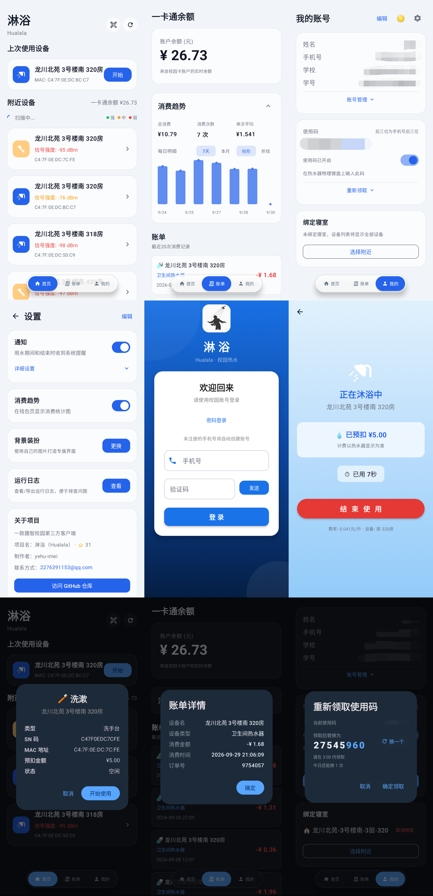

# 🚿 淋浴 (LinYu)

**⬇️ [下载 linyu-v3.1.2](https://github.com/yehu-imei/linyu/releases/tag/v3.1.2)**

> Android 支持 Android 8.0+、arm64-v8a；iOS 主应用需 iOS 16+，桌面小组件需 iOS 17+
>
> **国内下载慢？用 Gitee 镜像** → [https://gitee.com/yehu-imei/linyu/releases](https://gitee.com/yehu-imei/linyu/releases) App 内的更新下载默认也走镜像

趣智校园第三方 Android 客户端，用于控制校园热水器。相比官方 App，提供更简洁的界面和更流畅的操作体验

iOS 独立客户端：[GitHub 仓库](https://github.com/yehu-imei/linyu-ios) · [Gitee 镜像](https://gitee.com/yehu-imei/linyu-ios) · [IPA 发行](https://github.com/yehu-imei/linyu-ios/releases/tag/v3.1.2)

iOS 包需自签安装，详见 [安装教程](https://github.com/yehu-imei/Guides/blob/main/Tutorial/.ipa%E7%9A%84%E5%AE%89%E8%A3%85.md)，使用桌面小组件时须独立安装 App，并保留小组件扩展和共享权限

## 📱 预览

### 背景装扮

把喜欢的图片设成界面背景，App 会自动从图里提取主题色作为强调色；主页与使用页各存一套，互不影响

| 背景设置 | 主页 | 使用页 |
|---|---|---|
|  |  |  |

> 使用页套用自定义背景后不再显示设备 emoji——背景图本身就是画面主体。

### 桌面小组件

在桌面直接启停热水，不用打开 App

| 2x2 · 空闲 | 2x2 · 使用中 | 2x4 · 设备控制 |
|---|---|---|
|  |  |  |

| 2x4 · 附近设备 | 2x4 · 账单 |
|---|---|
|  |  |

## ✨ 功能

### 🚿 设备控制

- 🔐 **手机号登录** — 默认**短信验证码登录**（未注册的手机号会自动创建账号），也可切换密码登录；支持系统自动填充保存账号密码，登录状态持久化与自动恢复
- 📡 **蓝牙扫描** — BLE 扫描附近设备，按信号强度排序；权限按需申请，Android 12+ 不需要定位权限
- 🔌 **蓝牙水表直连** — 部分学校的表不联网，手机**通过蓝牙直连**即可开阀 / 关阀 / 结算：关阀即结清、遗留订单自动补结算、App 被杀重开能恢复用水；通知栏「结束使用」和桌面小组件都能走蓝牙关阀，App 被杀也能关
- 🎨 **统一的设备图标** — 热水器 / 洗手台用单色图标，不再受各厂商 emoji 字形影响
- 📷 **扫码绑定** — 扫描设备二维码，直接弹出设备详情，无需蓝牙；也可以**从相册选图识别**，光线不足时有**手电筒**
- 🏠 **绑定寝室** — 在「选择附近」里选一间寝室，首页**和桌面小组件**的设备列表都只显示该寝室的设备
- 🚿 **一键洗澡** — 选择设备即可开始，支持停止和恢复。云端开关水均复核设备状态，未确认时有提示
- ⭐ **常用设备** — 从上次使用、附近设备或设备详情收藏，常用设备可在首页排序
- ⏳ **自动关停倒计时** — 显示闲置自动关闭倒计时，关闭时弹出确认框
- 🔔 **后台用水监控** — 监控跑在前台服务里，**退出 App、划掉最近任务都不影响**：超时自动关停照常生效
- 🔕 **系统通知** — 用水期间通知栏常驻状态条并带「结束用水」按钮；结束、超时自动关停、**开阀失败**都有提醒
  - 开阀失败 / 设备被占用 / 超时关停会弹**横幅**，「横幅提醒」可单独关掉
- 💰 **消费结算** — 关阀后直接向服务端查这一单结算了多少钱，结束通知里给出**本次消费金额和用水时长**
- 🚰 **饮水机支持** — 自动识别直饮水机，按设备所属的已关联项目开关水、结算和查看消费。兼容性因学校和设备型号而异
- 🧩 **桌面小组件** — 1x1 / 2x2 / 2x4 三种尺寸，桌面直接启停热水；深色液态玻璃卡片，布局随尺寸自适应
  - **1x1 是一个按钮**：一格大小，点一下开/关；顶部小字标「空闲 / 使用中 / 占用中」，操作中显示转圈
  - 2x4 带侧边导航，可切换「设备控制 / 附近设备 / 账单」三页
  - 操作状态在桌面上**全局同步**：点任一个组件，所有淋浴组件同时显示「正在开启…」并转圈
  - 点「上次消费」卡片进 App 账单页；使用中点计时卡片直接关阀
  - 附近设备「选用」直接在桌面切换控制设备，不用打开 App

### 💰 钱包与账单

- 💳 **余额切换** — 点击账单页标题切换一卡通与趣智校园余额。两种真实余额都不可用时可手动估算
- 🧾 **残留账单补扣** — 12 点后结束用水或余额不足导致没扣成的账单，可以在账单上手动「请求代扣」
- 📋 **账单查询** — 合并近三个自然月的关联项目消费，支持详情和近 7 天 / 本月趋势。金额至少两位小数，第三位非零时显示三位

### 👤 账号

- 🪪 **个人信息卡片** — 姓名、学号、学校自动获取，不用手填
- 📱 **更换手机号** — 验证码发到新号码，改完即时生效
- 🔑 **修改密码** — 支持密码方式和**短信验证码方式**（没设过密码、或忘了密码都能用）
- 🎫 **使用码** — 领取 / 重新领取前可先预览，「换一个」每天 20 次，确定领取才真正替换；取消不会影响正在用的码

### 🎨 个性化

- 🖼 **背景装扮** — 主页与使用页各一套独立背景，自动提取主题色，支持透明度 / 模糊 / 亮度调节
- 🌓 **深浅主题** — 圆形揭示切换动画，设置自动保存
- 🧩 **卡片自定义** — 首页三个设备区块可排序和隐藏，「我的」与「设置」的卡片也可编辑
- 📶 **断网提示** — 网络异常时友好提示
- 👥 **挤号检测** — 多设备登录自动提醒，25 秒心跳轮询，被挤下线能及时弹出提示

### 🔧 其他

- 📜 **内置运行日志** — 内存 + 文件双缓冲，敏感信息自动打码，崩溃自动捕获，可一键分享导出
- 🔄 **应用内更新** — 自动比对 GitHub Release，更新日志读取独立的 [精简文档](docs/APP_CHANGELOG.md)，并可直接在应用内下载安装
  - **下载默认走 Gitee 镜像**，更新卡片里可切回 GitHub
  - 更新日志默认只列最近 3 个版本，点「展开全部」看其余
- 🔐 **加密存储** — 登录凭证加密存储（EncryptedSharedPreferences）

## 📖 文档

| 文档 | 说明 |
|---|---|
| [PROJECT.md](PROJECT.md) | 完整项目文档：技术架构、项目结构、构建方法、功能清单 |
| [CHANGELOG.md](CHANGELOG.md) | 版本更新日志 |
| [SECURITY.md](SECURITY.md) | 安全说明：如何验证正版、我们的安全设计、已知暴露面 |
| [API-qzxy.md](API-qzxy.md) | 趣智校园 API 逆向工程完整参考 |
| [开发者指南.md](开发者指南.md) | 面向第三方开发者的开发指南 |

> 欢迎提 Issue 或 PR 帮助改进！

## 🙏 感谢

感谢每一位为本项目做出贡献的朋友，是你们让「淋浴」从想法一步步变成今天的样子：

| 贡献者 | 贡献内容 |
|---|---|
| [@Cainite07](https://github.com/Cainite07) | 短信登录的实现 |
| [@SubmergeDQ](https://github.com/SubmergeDQ) | 蓝牙阀控制的实现 |
| [@XiaoLoad](https://github.com/XiaoLoad) | 项目优化的宝贵建议 |
| 各位同学们 | 软件的测试与体验反馈 |

> 每一段代码、每一条建议、每一次测试，都在让「淋浴」变得更好！谢谢你们 🙌

## 📄 许可证

[MIT License](LICENSE)

## ⚖️ 免责声明

本项目仅供学习和研究用途。使用者应自行遵守趣智校园及相关服务的使用条款。开发者不对因使用本项目产生的任何后果承担责任。
